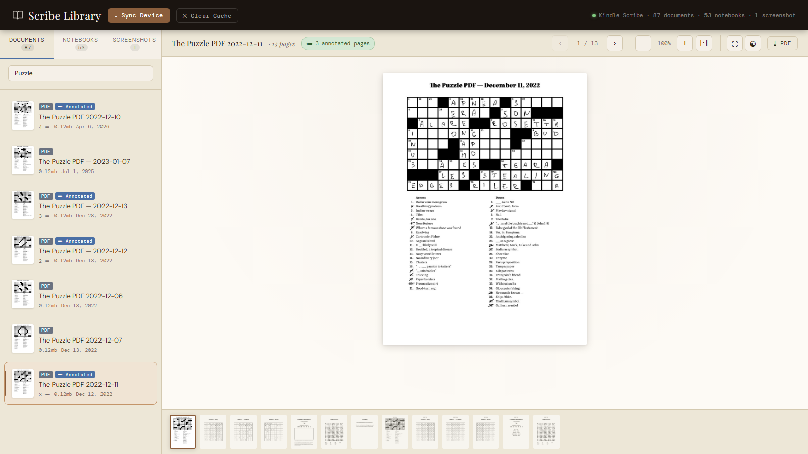

# Kindle Scribe local export

Get your handwriting off a Kindle Scribe: overlay your pen annotations onto the PDFs you sent to the device, and export standalone notebooks as PDFs.



## Why

Amazon converts PDF files to its internal KFX format, and everything you write on it is stored separately as stroke data. The official way to get an annotated PDF back (converting it on Amazon's servers and sending it via email) can fail for large documents.

This tool does the same job locally: it pulls the needed files off the device over USB, extracts your strokes, figures out which page each one belongs to, and produces annotated PDFs. No cloud round-trip, batch export of everything at once, and it handles documents the official export times out on.

Tested on a 1st gen Kindle Scribe with firmware 5.19.4.0.1.

## Usage

Connect the Scribe via USB and leave it in file-transfer mode. In both modes below, the base PDF of each document is extracted from the device's own KFX copy - for Send-to-Kindle conversions those are the original pages, text layer and quality preserved.

### Web UI

```
python server.py
```

Open http://127.0.0.1:7070 - a local web app (design inherited from the original scribe-library project) with three tabs: **Documents**, **Notebooks**, **Screenshots**. One button syncs the device over USB (with a progress bar); opening a document exports it with your annotations overlaid, and everything can be read in the browser - page-flip book mode and zen mode included - downloaded as PDF, or multi-selected and downloaded as a ZIP. Documents and notebooks can be renamed right in the app (click the title, or the pencil on a list entry); downloads use the new names. Conversions are cached next to the app in `cache/web/` (the Clear Cache button resets it), so documents open instantly after the first time. Nothing leaves your machine.

#### Uploading documents

The **Upload** button puts documents from your computer on the Kindle, two ways:

- **Send to Kindle** (recommended) - hands the files to Amazon's [Send to Kindle for PC](https://www.amazon.com/sendtokindle), exactly like Explorer's right-click *Send to Kindle* (it runs the app's `StkSendToHandler.exe <files>`). Pick your device and click Send in its window. Amazon converts the files and delivers them over Wi-Fi, and you can write on PDFs and export them later. This tool never handles your Amazon credentials. The app is found automatically; otherwise pass `--stk-handler "<path>\StkSendToHandler.exe"` or set `STK_HANDLER`.
- **Copy over USB** - copies PDF/EPUB/TXT straight into `documents/Uploads` on the connected device. Instant and offline; the files stay sideloaded documents.

The same USB copy works from the command line: `python scribe_mtp.py --upload file1.pdf file2.epub`.

### Command line

For batch exports and scripting:

```
python scribe_annotate.py                         # export all annotated documents to output/
python scribe_annotate.py --all                   # everything: documents + standalone notebooks
python scribe_annotate.py --filter Planner        # only documents whose name contains "Planner"
python scribe_annotate.py --export-notebooks      # standalone notebooks only
python scribe_annotate.py --output my_export      # output directory (default: output/)
python scribe_annotate.py --save-annotations      # save each annotation as a transparent PNG too
```

Re-runs are incremental: documents without new ink since the last export are skipped.

### Without the device

If you have a backup of the Scribe's storage — a full mirror (`.notebooks/` + `documents/`) or just a loose folder with `.sdr` folders, `.kfx` files and notebook folders dumped side by side — point the tool at it; content is found by name patterns, the directory layout doesn't matter:

```
python server.py --staging "D:/Scribe backup"
python scribe_annotate.py --scribe-dir "D:/Scribe backup" [--export-notebooks]
```

Run with `--help` for all options.

## Output (command line)

```
output/
  annotated/       your documents with handwriting overlaid
  reconstructed/   the same documents without annotations (originals recovered from the device)
  notebooks/       standalone notebooks as PDFs
  annotations.log.tsv / .json   index of every annotation (document, page, bookmark title)
  scribe_annotate.log           full run log
```

Notebook files are named by their internal UUID - Amazon keeps notebook display names in a database that is not accessible over USB. You can assign names to them in the web UI (they stick, and downloads use them).

## Installation

- Python 3.10+, then `pip install -r requirements.txt` (PyMuPDF, cairosvg, Pillow, pikepdf, Flask for the web UI,...)
- cairosvg needs a native cairo library. Windows: easiest via the [GTK runtime installer](https://github.com/tschoonj/GTK-for-Windows-Runtime-Environment-Installer). macOS: `brew install cairo`. Linux: `apt install libcairo2`.
- USB sync is **Windows-only** (it uses the Windows Shell MTP API). On other platforms, copy the files off the device manually and use `--scribe-dir`.

## Good to know

- Repeat runs are cheap: device sync skips files already copied and unchanged, page-position maps are cached in `cache/`, and documents without new ink since the last export are skipped.
- Newer firmware (seen from Sept 2026) no longer writes handwritten-note page anchors into the `.yjr` sidecar. The Kindle keeps them in `system/ksdk/.annotations/<account>/ksdk_annotation_v1.db`, which the sync now copies, and the export falls back to it automatically. Before this, such documents exported with no annotations at all. The same firmware change seems to remove the device's own *Share* button for these documents.
- Sync re-copies files that changed on the device (size/date), so notebooks you keep writing in stay current.
- `--page-map map.json` (`{note_id: page}`) places ink pages by hand when no index exists anywhere.
- Annotations are overlaid as vector strokes - crisp at any zoom, small output files.
- Only documents sent to the device (send to kindle) or created on it are processed.
- Documents that were converted to a reflowable text layout (rare; PDFs are unaffected) carry no page content and can't be exported.
- KFX/KDF decoding is done by the vendored [kfxlib](https://www.mobileread.com/forums/showthread.php?t=291290) by John Howell (GPL v3), lightly modified to skip a slow validation pass.

## Credits

- Based on [technolaaji/scribe-library](https://github.com/technolaaji/scribe-library): the file-format research and the web UI design come from there; the sync and export pipeline is a rewrite.
- KFX/KDF decoding © John Howell ([kfxlib](https://www.mobileread.com/forums/showthread.php?t=291290), GPL v3, vendored).

- Created with Claude Fable 5.

## License

GPL v3 - see [LICENSE](LICENSE).
